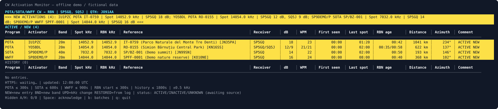

# CW Activation Monitor

[](https://github.com/rafal-dot-ai/cw-activation-monitor/actions/workflows/tests.yml)
[](https://www.python.org/)
[](LICENSE)

Find CW activators reported by POTA and WWFF and check whether your selected
Reverse Beacon Network receivers have heard them.

A Linux terminal monitor for **POTA, WWFF and optionally SOTA**, showing CW
activations confirmed by **SP5GQ or SQ5J**. Requires **Python 3.10 or newer**
and HTTPS access. No third-party libraries, account or login are required for
POTA/WWFF. The interface and CLI help use English; reference names retain the
language supplied by their source.



*Offline demonstration using fictional station data.*

- Incremental terminal display with new activation alerts and history.
- Separate program spot age limits and RBN reception checks.
- Adaptive polling with a smoothed traffic average and recent peak history.
- Distance from your own QTH, in kilometres or miles, and initial azimuth.
- Optional CSV event and diagnostic logs.
- Optional persistent daily CSV summaries with full reference names and first/last source spots.
- Optional SOTA import from a local JSON file.

## Running

Clone the repository and keep `pota_alert.py` and `terminal_display.py` together:

```bash
git clone https://github.com/rafal-dot-ai/cw-activation-monitor.git
cd cw-activation-monitor
python3 pota_alert.py --demo --qth JO91AA
```

For live POTA/WWFF monitoring, supply your own QTH when you want distances:

```bash
python3 pota_alert.py --qth JO91AA
```

By default the monitor fetches **POTA and WWFF**, immediately and then every
60 seconds. SOTA currently uses an optional **local JSON file**, described
below; it does not connect to the SOTA API.

Select programs or set their independent maximum spot ages:

```bash
python3 pota_alert.py --programs POTA WWFF
python3 pota_alert.py --programs POTA
python3 pota_alert.py --pota-max-age 300 --sota-max-age 600 --wwff-max-age 900
```

| Program | Default spot age | Source |
|---|---|---|
| POTA | 300 s / 5 min | Public POTA HTTPS JSON |
| SOTA | 600 s / 10 min | Local JSON file supplied with `--sota-file` |
| WWFF | 900 s / 15 min | Public WWFF Spotline HTTPS JSON |

These are the monitor's configurable freshness limits, not proof that an
activation ended. WWFF uses a longer default because Spotline suppresses
similar duplicate spots within a 10-minute window. See the
[Spotline information](https://spots.wwff.co/info).

Each age limit is applied consistently when selecting spots, matching a new
entry to RBN, maintaining ACTIVE status and starting inactive history retention.
Changing `--wwff-max-age` does not change POTA or SOTA. The separate
`--rbn-max-age` defaults to 300 seconds and limits initial RBN confirmations
for every program. `--new-max-age` defaults to 300 seconds and controls time
in ACTIVE / NEW; `--history-max-age` defaults to 1800 seconds after inactivity.
`--timeout` controls each HTTPS request timeout, default 20 seconds.

In an interactive terminal, **curses** draws only changed fields. Network
requests run in the background. Exit with `q` or `Ctrl+C`, even during a slow
request. Curses is part of Python's standard library; if unavailable, the
program falls back to plain text. Redirected output, `TERM=dumb` and
`--no-clear` produce successive text snapshots.

Optional event logging:

```bash
python3 pota_alert.py --log-file activations.csv
python3 pota_alert.py --log-file diagnostics.csv --log-level debug
```

Daily summary only, or both independent CSV files with four hours of history:

```bash
python3 pota_alert.py --summary-file daily.csv
python3 pota_alert.py --history-max-age 14400 --bell --log-file events.csv --summary-file daily.csv
```

Examples:

```bash
# All three programs, with fictional data and no network access:
python3 pota_alert.py --demo

# One live POTA/WWFF check with links (exit code 1 on source errors):
python3 pota_alert.py --once --links

# Audible alert for newly confirmed entries:
python3 pota_alert.py --bell

# Keep successive text snapshots:
python3 pota_alert.py --no-clear
```

## SOTA: local file support

Direct SOTA API access is **not enabled**. The previously used API endpoint
now returns a deprecation notice. The current
[SOTA API terms](https://api-db2.sota.org.uk/docs) require prior approval for
AI-generated applications and a designated developer contact. This monitor
makes no requests to either SOTA API endpoint. Automatic SOTA API fetching
would need approval and verification of the approved current interface.

To display SOTA entries now, supply a local JSON export from a source you
are authorized to use:

```bash
python3 pota_alert.py --sota-file /path/to/sota-spots.json --sota-max-age 600

# Monitor only the local SOTA feed, plus RBN confirmation:
python3 pota_alert.py --programs SOTA --sota-file /path/to/sota-spots.json
```

Supplying `--sota-file` adds SOTA to the default POTA/WWFF selection. An
explicit `--programs` selection takes priority. `--programs SOTA` requires
`--sota-file`, except for `--demo`. The file is re-read every polling cycle;
the script does not create or download it. Another authorized data producer
may update the file, preferably by replacing it atomically to avoid a partial
JSON read. A file error is reported without discarding previous valid data.
Reading the same file again does not refresh spot timestamps.

The preferred file format is a JSON array with these fields:

```json
[
  {
    "activator": "SP9ABC/P",
    "reference": "SP/BZ-001",
    "frequency_khz": 7032.0,
    "mode": "CW",
    "spot_time": 1794324000,
    "reference_name": "Example summit",
    "latitude": 49.57,
    "longitude": 19.53,
    "remarks": "CQ"
  }
]
```

This is a format example: `spot_time` must contain the actual report's Unix
UTC timestamp. A stale example will correctly be excluded by the age filter.
Names, coordinates and remarks are optional. An empty array means no current
spots. Files are limited to 8 MB.

The importer also accepts SOTAwatch-style export fields:
`activatorCallsign`, `associationCode`, `summitCode`, `frequency` **in MHz**,
`mode`, `timeStamp` as an ISO UTC timestamp, `summitDetails` and `comments`.
For normalized files, `frequency_khz` is explicitly **in kHz** and `spot_time`
is Unix seconds. Planned alerts are not activation spots and must not be
supplied as live spots. Deprecated API placeholder responses are rejected.

## Table and identity

The first column is **Program**, with `POTA`, `SOTA` or `WWFF`. Column order:

**Program → Activator → Band → Spot kHz → RBN kHz → Reference → Receiver →
dB → WPM → First seen → Last spot → RBN age → Distance → Azimuth → Comment**.

Reference means a POTA park, SOTA summit or WWFF area. The field includes the
reference's name in parentheses when available. The former POTA-specific
labels have become **Spot kHz**, **Last spot** and **Reference**.

An entry's identity is **program + callsign + band + reference**. A station
activating POTA and WWFF simultaneously has two separate rows. Within one
program, a different reference or band creates a separate row. Frequency
adjustments within a band, newer report times, names and coordinates update
the existing entry, without resetting First seen. All timestamps use UTC.
Activator callsigns are exact: `F5NLX/P` and `F5NLX` are separate identities.
Receiver skimmer suffix `-#` is removed, while SSIDs such as `-2` are preserved.

A new row appears only when:

- The program's latest report for that identity is CW, is not marked invalid
  or QRT, and satisfies that program's age limit.
- SP5GQ or SQ5J reported the same callsign in CW within `--rbn-max-age`.
- The reception is on the same band and differs from the reported frequency
  by at most `--tolerance`, default **0.5 kHz**.

Latest reports are selected by timestamp rather than JSON order. A newer
QRT or non-CW report is applied before filtering, so it cannot revive an older
CW spot. Changes in another program/reference do not disable this identity.
SOTA/WWFF test reports marked TEST are also treated as inactive.

**Spot kHz** is the latest frequency from the program's report. **RBN kHz**
is the latest stored frequency among the displayed receivers, shown separately
even when it differs. **Band** comes from the reported frequency, using POTA's
band ranges; an unknown range is `—`. After a frequency change, stored RBN
data describe the earlier observation rather than a new confirmation on the
changed frequency. Frequency changes do not claim improved propagation.

When both receivers are shown, dB, WPM and RBN age follow Receiver order,
separated by `/`. The latest matching reception is chosen for each receiver,
even if an earlier spot had better SNR.

| Age column | Meaning |
|---|---|
| **First seen** | Time since this confirmed identity was first detected during this run; updates and returns from history never reset it. Not the activation's actual start time. |
| **Last spot** | Age of the latest report from this row's program, using its original source timestamp. Re-fetching does not reset it. |
| **RBN age** | Age of the stored reception, separately for each receiver. Cached confirmation never refreshes its timestamp. |

Ages use **minutes:seconds**, such as `12:34/08:07`. Minutes do not wrap after
an hour: one hour is `60:00`. Counters update locally between requests and in
history. In narrow terminals, age columns may move below their entry.

## Distance, azimuth and reference names

Distance and Azimuth are adjacent, immediately before Comment. Distance uses **kilometres** by default,
rounded to whole units, for example `1234 km`. Set your own QTH with `--qth`
or the `CW_ACTIVATION_QTH` environment variable. Without a QTH, the monitor
runs normally and displays `—` for distance and azimuth. A warning above the
table remains visible for the first 30 seconds, including while the first
request is in progress. Plain text mode prints the warning once before
fetching data. Neither mode pauses monitoring.

```bash
python3 pota_alert.py --qth JO91AA --distance-unit mi
python3 pota_alert.py --qth JO91AA
python3 pota_alert.py --qth=52.23,20.88
export CW_ACTIVATION_QTH=JO91AA
python3 pota_alert.py
```

`--qth` accepts a 2-, 4-, 6- or 8-character Maidenhead locator or decimal
latitude,longitude. Use a decimal point and `--qth=-33.87,151.21` for a negative
latitude. Locator positions use the cell centre. Miles are statute miles.
Distance is calculated locally to the reference coordinates supplied by its
source, not to the RBN receiver or the activator's precise operating position.
It is a great-circle distance, not a signal path or road distance. Explicit
latitude/longitude take priority over `grid6`/`grid4` locator centres. Missing
coordinates show `—`; missing metadata preserves a previously known location.
Names and coordinates do not cause extra requests. History retains them.

The reference label includes its Maidenhead QTH after the name, for example
`IT-0759 (Parco Naturale…) [JN34PX]`. Valid source locators are preserved in
uppercase, including 4- or 8-character values when available. When only
coordinates are supplied, the monitor derives a 6-character locator. Missing
QTH metadata does not erase a previously known locator.

Both CSV files store the reference locator in `qth`: after `name` in the daily
summary, and after `reference` in the event log. It is independent of your own
`--qth`. On restart, the stored locator centre provides an approximate reference
position immediately; fresh source coordinates take priority when they arrive.

**Azimuth** is the initial great-circle bearing from your QTH to the
reference location, in whole degrees clockwise from **true north**:
`000°` north, `090°` east, `180°` south and `270°` west. It is calculated
locally from the same coordinates as Distance and does not depend on whether
distance is shown in kilometres or miles. Missing coordinates and positions
without a unique bearing (the same point, antipodes or a QTH at a pole) show
`—`. In narrow terminals, Azimuth moves below the entry with its label,
alongside other omitted fields as screen height permits.

Full reference names are shown by default and wrap below the row when needed,
subject to screen height. Every wrapped name line uses the main row's style:
new entries retain black text on yellow, active entries use their normal
style, and inactive history is dimmed. Highlight expiry and Space update the
name lines together with the row. To truncate or hide names:

```bash
python3 pota_alert.py --reference-name-length 32
python3 pota_alert.py --reference-name-length 0
```

The previous `--park-name-length` option remains an alias.

## Display, markers and history

Headers are bold, with a dim horizontal rule beneath them. At **120 terminal
columns or more**, dim grey `│` separators distinguish the columns; narrower
terminals use single spaces. Numeric fields are right-aligned; program,
activator, band, reference, receiver and Comment are left-aligned. The layout
accounts for separator widths, wide characters and wrapped Comment lines.
In very short windows the rule is omitted to preserve room for entries.
Plain text snapshots retain ASCII separators and numeric alignment.

New confirmations appear in a **NEW ACTIVATION / NEW ACTIVATIONS** banner at
the top for 60 seconds, with program, reference, frequency, receivers and SNR.
Source errors and warnings also appear above the table. Remaining information
and keyboard controls appear below it.

New rows use **black text on yellow for 30 seconds**, configurable with
`--highlight-seconds`. Colored highlights do not use bold, preventing themes
from turning black text white. Monochrome terminals use bold/reverse video.

The final **Comment** column contains program spot status and event markers:

| Value | Meaning |
|---|---|
| `ACTIVE` | The last valid CW spot is within this program's age limit |
| `INACTIVE` | The spot expired, or QRT/non-CW/invalid status was received |
| `NEW` | This program/callsign/band/reference was detected less than a minute ago |
| `BND` | New band for a known callsign within this program |
| `UPD` | Frequency changed within the same identity |

Markers can coexist, e.g. `ACTIVE NEW BND` or `ACTIVE NEW UPD`.
UPD appends a description, e.g. `Spot 14052.9 → 14053.1 kHz`, for 60 seconds.
Descriptions wrap under Comment; there is no separate UPDATED line. Changed
frequency cells use **black underlined text on white**, without bold, while
other cells retain their styles. Monochrome terminals use underline/reverse.
Separators remain subdued. Space or expiry removes highlights without a clear.

**Space** acknowledges current banners, markers, highlights and update
messages, preserving data and order. Re-fetching the same record does not
restore the highlight. New entries are highlighted normally. `--bell` rings
once per new confirmed identity, never for ordinary updates. Space works in
curses mode; `q` and `Ctrl+C` exit. Press **b** to allow smaller RBN batches
if the receiver stream is truncated. This is a non-blocking choice; the
monitor continues to update while displaying the incomplete-results warning.

The table has two sections:

- **ACTIVE / NEW:** active identities first detected within `--new-max-age`,
  default **5 minutes**. This period is separate from program spot age limits.
- **HISTORY:** older or previously archived identities. They can still be
  **ACTIVE**. Inactive entries are dimmed and retained for
  `--history-max-age`, default **30 minutes after activity ends**.

Activity ends according to that row's own program deadline, or an explicit
stop report, not the age of its RBN reception. A known identity remains in
history through updates and reactivation. A temporary absence in a successful
source response may archive it, while its last valid report remains active
until expiry. A source failure alone does not archive its entries or renew
their timestamps. QRT for one reference/program does not disable another.

Newest entries have priority when the screen fills. History prioritizes
active entries and newer source reports. The footer counts hidden active and
history entries. Column widths grow with content and reset on terminal resize,
avoiding shifting columns when entries disappear. Optional columns move below
the row or are omitted from the table; details depend on available height.
Frequency sources and Program remain visible in supported narrow windows.
History is in memory only, with identity retained until exit even after an
inactive entry becomes hidden, preventing duplicate alerts on its return.

The **`HTTPS in 00:47`** countdown updates locally every second. During a
request it shows **`HTTPS: fetching…`**. Ages, deadlines and highlights update
between requests, even while a fetch is slow. The screen does not clear each
minute; only changed cells are repainted. `--once`, `--demo` and `--no-clear`
use full snapshots. `--links` adds program reference and RBN links, as space
permits in curses mode.

## Independent sources and RBN caching

POTA and WWFF are fetched once per cycle, concurrently, with independent
error handling. The SOTA file is read concurrently when enabled. A malformed
or unavailable source produces an error while other sources continue to
update. Last known records retain their original deadlines. A source's
`Retry-After` pauses only that source; the others keep their normal schedule.
RBN failures preserve source updates and cached confirmations. A single cycle
can therefore display valid updates and a source error together. `--once`
returns exit code 1 if any source failed.

RBN now fetches a shared CW stream for the selected receivers, caches spots
by their RBN IDs and locally intersects that cache with the activation
callsigns requiring confirmation, across all enabled programs. With no
suitable unconfirmed spots there are no RBN spot queries. Once confirmed,
**program + callsign + band + reference** is remembered until exit. Frequency
updates or new reports for it do not require another RBN confirmation.
Unconfirmed identities are retried; a different program, band or reference
requires a fresh matching reception. One fresh reception may match multiple
simultaneous references/programs. Cached receptions keep their original time
and receivers; the monitor does not continuously search for new SNR values
or extra receivers for confirmed identities.

An RBN spot confirms **signal reception**, not a completed QSO. A missing row
means no qualifying confirmation, not proof that a station is inaudible.
RBN's schema/version are checked. Its website interface is not a documented stable API, so changes
may require monitor updates. The monitor publishes nothing to any service.

## Adaptive RBN request size

Each receiver-set/age-limit profile keeps its own request limit, smoothed
traffic rate and recent peak history **in memory for this run**. This changes
how data are fetched; initial RBN freshness still defaults to **5 minutes**,
and program spot age limits and cached confirmation lifetimes are unchanged.

- Requests begin at **10 rows**, with levels **10 → 20 → 50 → 100**.
- If a full response does not cover the needed time window, the limit grows
  immediately and the request is repeated in the same cycle. A response
  shorter than the requested limit does not cause another increase.
- The first read covers the entire RBN freshness window. Later reads must
  reach the last complete read with a **15-second overlap**, bounded by the
  freshness window. A fixed one-minute cutoff would miss data after a slow
  request or an error. Overlapping responses are deduplicated by spot ID.
- New IDs per actual elapsed minute update an exponential moving average
  with weight **0.3** for the newest sample. The largest rate from the last
  **10 complete samples** provides peak protection. The target is the larger
  of **average × 1.5** and **peak × 1.2**, scaled to the requested window and
  rounded up to an available row limit.
- Growth is immediate. Shrinking requires **three complete quieter samples**
  and proceeds one level at a time. Repeated IDs do not inflate the average.
- A truncated response is only a lower bound on traffic. It does not train
  the average, clear remembered peaks or advance the complete-read timestamp.
  HTTP errors likewise preserve the timestamp. Recovery covers the relevant
  gap within the configured freshness window, and expired cached spots are
  removed.

If **100 rows still do not cover the window**, the monitor displays an
**incomplete stream** warning. It continues displaying valid data, but
qualifying matches may be missing. Press **b** in curses mode to allow
targeted batches split by callsign and receiver. That choice lasts for the
run; batches are used when needed, while a complete stream can still be used.
The global stream watermark is not advanced merely because targeted
batches succeeded. A single callsign/receiver pair can itself exceed 100;
that remaining limitation is reported explicitly.

For plain text, unattended operation or a one-shot check, opt in at startup:

```bash
python3 pota_alert.py --rbn-small-batches
python3 pota_alert.py --once --rbn-small-batches
```

The footer shows mode, used → next row limit, average and peak rates, for
example `RBN stream: rows 20→20 | avg 8.0/min | peak 10.0/min`. A dash means
no complete measurement yet. Short terminals may omit this extra status
line; plain snapshots include it. Increasing the limit can require several
requests with repeated rows, so adaptive fetching primarily controls payload
size and does not guarantee lower server load on every cycle.

## Optional CSV log

`--log-file PATH` appends UTF-8 CSV records and writes the header once. With
no option, no log file is created. Default level **events** records:

- `NEW`: first confirmation of an identity.
- `BAND`: a new band for an already known callsign in the same program.
- `UPDATE`: a changed source report, frequency, metadata or reception.
- `HISTORY`, `INACTIVE`, `ACTIVE`: actual section/activity transitions,
  including local expiry between requests and later reactivation.
- `SOURCE_ERROR`, `SOURCE_OK`: source error changes and recovery.
- `RBN_BATCHES_ENABLED`: keyboard acknowledgement of smaller batches.

An identical fetched report, a redraw, a countdown tick or repeated calls to
the lifecycle code do not generate duplicate events. New source timestamps
are updates even if frequency is unchanged. BAND is the event for that new
entry, rather than an additional duplicate NEW event.

Column order is:

```text
timestamp_utc,source_time_utc,event,program,callsign,reference,qth,band,spot_khz,rbn_khz,receivers,snr_db,wpm,detail
```

`timestamp_utc` is the event recording time; `source_time_utc` is the original
program report time. Multiple receivers use `/` in matching order.
The log preserves timestamps rather than saving a constantly changing
age. Standard CSV quoting handles commas and quotes; CSV can be read by
spreadsheets or processed from the terminal. The log is flushed after each
record and shared safely between terminal and polling threads.

**debug** adds source read counts/errors, `RBN_QUERY` request limits and
returned counts, `RBN_FETCH` adaptive status, and `RBN_REJECT` explanations
(no recent report, receiver, age, band or frequency mismatch). It can produce
records each polling cycle and is intended for diagnosing missing entries:

```bash
python3 pota_alert.py --log-file diagnostics.csv --log-level debug
```

Existing logs use the current header. The preceding schema without `qth` is
upgraded automatically, adding an empty column and preserving the original
file in `.csv-backups/`. Other headers or inaccessible files fail clearly at
startup. A write failure during operation is reported above the table and leaves
monitoring running. The file's parent directory must already exist.
On restart, saved activation events restore recent terminal history as
described below.

## Optional daily CSV summary

`--summary-file PATH` maintains a separate UTF-8 CSV, independent of
`--log-file`. Enable either file or both. It uses the same confirmed CW
activations as the monitor and makes **no additional network requests**.
Unconfirmed spots and explicit QRT/non-CW reports are not added to the summary.

There is **one row per UTC day + program + callsign + reference + band**.
Frequency changes within a band update that row. Another program, callsign,
reference, band or UTC day creates another row. All days are kept in the same
file. Rows are sorted by day and identity.

| CSV column | Meaning |
|---|---|
| `date_utc` | UTC calendar date of the source report |
| `first_seen_utc` | Earliest source report timestamp observed for this identity and UTC day |
| `last_seen_utc` | Latest source report timestamp observed for this identity and UTC day |
| `program` | POTA, SOTA or WWFF |
| `callsign` | Exact activator callsign, including portable suffixes |
| `reference` | Park, summit or nature-area reference |
| `name` | Full reference name, independent of terminal truncation settings |
| `qth` | Reference Maidenhead locator, usually 6 characters; blank if unavailable |
| `band` | Band, such as 20m or 40m; an unrecognized range uses the frequency-based identity |
| `last_frequency_khz` | Program frequency from the latest source report |

Names come from POTA `name`/`parkName`, WWFF `reference_name`, or the local
SOTA file's `reference_name`/`summitDetails`. Commas, quotes and Unicode names
are preserved using normal CSV quoting. A missing name leaves the cell blank;
a later report can fill it. Missing metadata never erases an existing name.

First/last times are **source timestamps**, rather than detection times,
poll times or RBN reception times. Re-fetching the same report, a local timer
tick, moving a row to history, inactivity and a failed source do not advance
Last seen. Confirmed ACTIVE entries in history still update the summary when
a new source report arrives. The interval between First seen and Last seen
is the span of observed reports, not a measurement of continuous activity or
the activation's actual start/end. If a station returns to the same place and
band on the same day, the visits are combined into that day's row.

The day also comes from the source timestamp. Re-fetching a pre-midnight
report after midnight keeps it in the preceding UTC day. A post-midnight
source report creates the next day's row.

On startup, the existing summary is validated and loaded. Its first sightings
and old days are retained, newer observations update the same keys, and an
older report cannot roll back Last seen or its frequency. Valid duplicate
keys in an existing file are merged. Recent rows also supplement restored
terminal history. A summary alone does not identify a confirming RBN receiver.

Updates replace the CSV atomically after a complete polling snapshot; identical
data do not rewrite it. On a write failure, the old CSV stays intact, the
monitor shows **SUMMARY ERROR**, and the next snapshot retries the pending
changes. An invalid existing file is rejected without overwriting it. Its
parent directory must already exist.

A small hidden lock file, e.g. `.daily.csv.lock`, prevents two monitor
processes from overwriting the same summary. It can remain after exit; the
actual lock is released when the process closes it. Generated CSV, lock and
temporary files are ignored by Git. Event and summary output must use
different files.

## Resume after restarting

Use the same log paths and history limit when restarting:

```bash
python3 pota_alert.py --history-max-age 14400 --bell --log-file events.csv --summary-file daily.csv
```

Existing files are read before fetching live data. `events.csv` restores
activation identities, detection times, source timestamps, receiver details
and activity transitions. `daily.csv` supplies full reference names and
first/last source observations, including confirmed identities missing from
the event log. Either file can also be used on its own.

Restored entries appear in **HISTORY** with **RESTORED** in Comment. Their
initial status is **UNKNOWN** until the program source is read successfully.
Old entries do not trigger NEW highlights or the bell. A fresh program report
can mark an entry ACTIVE while keeping it in HISTORY. A saved confirmation
from a currently selected receiver is reused; entries available only in the
daily summary still need an RBN confirmation. New bands and references remain
separate identities.

The configured per-program spot age and `--history-max-age` apply to saved
timestamps, including time while the monitor was stopped. Restarting does not
extend retention or update the daily summary. Invalid event records are
skipped with a warning; malformed CSV syntax and incompatible headers produce
a startup error.

The CSV files store reference locators rather than exact coordinates. Distance
and Azimuth can be calculated from the stored QTH immediately; without a saved
QTH they remain `—` until coordinates arrive in a fresh source report.
RBN age remains `—` for restored receptions until an
actual timestamped reception is available. Without a NEW/BAND event, the
detection time for First seen is unknown and also shown as `—`; daily source
timestamps are preserved with their original meaning. Demo mode ignores
saved real entries.

## Options

```bash
python3 pota_alert.py --help
```

| Option | Default | Meaning |
|---|---|---|
| `--programs POTA SOTA WWFF` | POTA WWFF | Programs; SOTA requires its local file |
| `--sota-file PATH` | none | Local SOTA spots JSON; adds SOTA unless programs are explicitly selected |
| `--pota-max-age SECONDS` | 300 | Maximum POTA report age |
| `--sota-max-age SECONDS` | 600 | Maximum SOTA report age |
| `--wwff-max-age SECONDS` | 900 | Maximum WWFF report age |
| `--spotters CALL [CALL ...]` | SP5GQ SQ5J | Either receiver is sufficient |
| `--interval SECONDS` | 60 | Polling interval, minimum 60 s |
| `--rbn-max-age SECONDS` | 300 | Maximum initial RBN reception age |
| `--history-max-age SECONDS` | 1800 | Inactive history retention after the program's deadline/stop |
| `--new-max-age SECONDS` | 300 | Duration in ACTIVE / NEW |
| `--highlight-seconds SECONDS` | 30 | Strong new row highlight duration |
| `--reference-name-length CHARS` | full name | Name limit; 0 hides names; alias `--park-name-length` |
| `--qth LOCATOR` or `--qth=LAT,LON` | CW_ACTIVATION_QTH, otherwise unset | Home position for distance calculations; CLI overrides environment |
| `--distance-unit {km,mi}` | km | Kilometres or statute miles |
| `--tolerance KHZ` | 0.5 | Initial frequency matching tolerance |
| `--timeout SECONDS` | 20 | Timeout per HTTPS request |
| `--rbn-small-batches` | off | Allow targeted batches if the adaptive receiver stream is incomplete |
| `--log-file PATH` | none | Append event records to a UTF-8 CSV log |
| `--log-level {events,debug}` | events | Include fetch and rejection diagnostics with debug |
| `--summary-file PATH` | none | Maintain a persistent daily CSV with full names, first/last source spots and last frequency |
| `--links` | off | Show program reference and RBN links |
| `--bell` | off | Bell for new confirmed identities |
| `--no-clear` | off | Plain text snapshots instead of curses |
| `--once` | off | One cycle, exit code 1 on source failure |
| `--demo` | off | Offline fictional examples, all three programs by default |

The interval is measured between cycle starts when requests finish within it.
The snapshot is dated after fetching and ages are checked again for display.
Keep the system clock correct.

## Sources and portability

- POTA: <https://api.pota.app/spot/activator>.
- WWFF: <https://spots.wwff.co/static/spots.json>; integration details at
  <https://spots.wwff.co/info>.
- SOTA: user-supplied local JSON only; API terms at
  <https://api-db2.sota.org.uk/docs>.
- RBN: <https://www.reversebeacon.net/main.php> and its `/spots.php` JSON.

To use another computer, clone this repository, download a ZIP from
[Releases](https://github.com/rafal-dot-ai/cw-activation-monitor/releases), or copy:

- `pota_alert.py`
- `terminal_display.py`
- `README.md`
- `LICENSE`

If SOTA is enabled, also copy your own JSON feed or configure its new local
path. That personal feed is not included in the ZIP. The offline demo needs
no extra file and never accesses any network source.

## Tests

```bash
python3 -m unittest discover -s tests -v
```

GitHub Actions runs the offline tests and demo on Linux with Python 3.10,
3.12 and 3.14. Tests use controlled data and do not call live radio services.
The demo smoke test writes both the event log and daily summary.

## License

Released under the [MIT License](LICENSE).
